## h4

### x) Lue ja tiivistä.

Tärkeimmät funktiot:

- Demoneiden asentamiseen: package, file, service
- Ohjelmien asentamiseen: package, file
- Käyttäjien hallintaan: user, group
- Tiedostojen manipulaatioon: file, directory, symlink     

### a) Räpylä. Asenna itse valitsemasi demoni käsin. Jokin muu kuin tunnilla tai kotitehtävissä aiemmin asennettu, eli ei apache, ngninx eikä openssh-server. Kuten aina, testaa lopputulos.

Valitsin demoniksi Dockerin. Docker asennetaan Debianin pakettivarastosta komennolla:

    sudo apt-get install -y docker.io

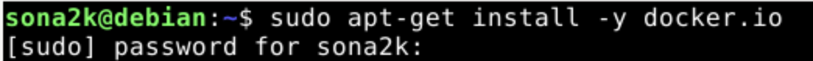

Asennuksen jälkeen tarkistetaan palvelun tila komennolla:

    systemctl status docker

Palvelu on `active (running)` ja `enabled`, eli se käynnistyy myös koneen käynnistyessä. Docker käynnistyi siis automaattisesti asennuksen yhteydessä.

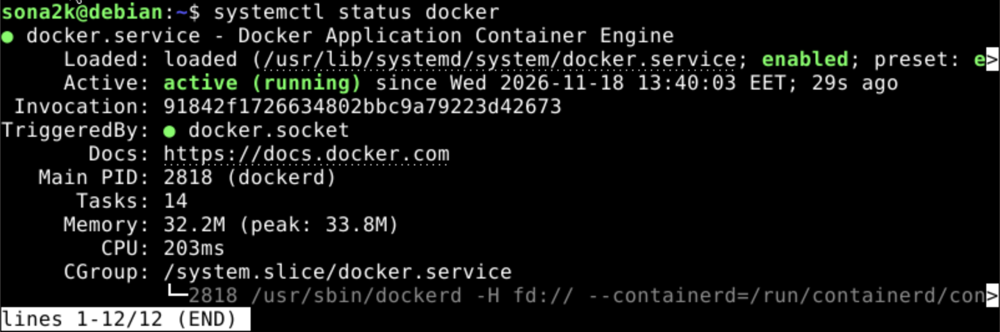

### b) Automaatti. Automatisoi valitsemasi demonin asennus Ansiblella.

Luodaan Ansibleen rooli docker ja sille tasks/main.yml, jossa määritellään, että docker.io-paketti on asennettu ja palvelu käynnissä sekä käynnistyy automaattisesti koneen käynnistyessä.

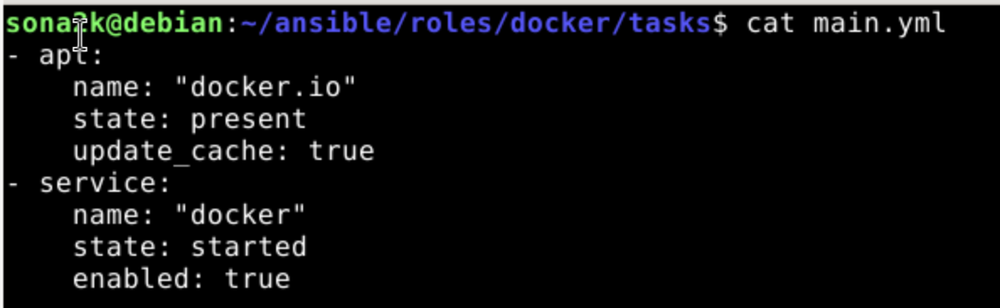

Lisätään rooli site.yml-tiedostoon.

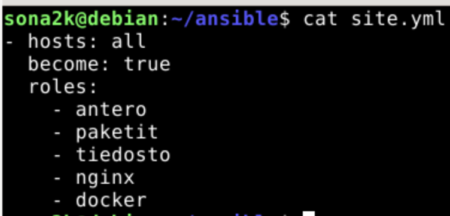

Ajetaan playbook. Kaikki Docker-roolin tehtävät palauttavat ok ja PLAY RECAP näyttää changed=0, eli ajo on idempotentti: Docker oli asennettu käsin jo aiemmin, joten Ansible ei muuttanut mitään.

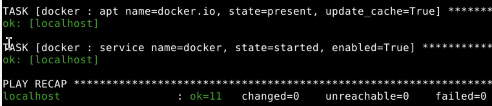

### c) Asetus. Muuta asetustiedostoa herralla (master, "control node") ja aja ansible uudestaan. Osoita, että asetukset tulivat käyttöön.

Dockerin asetustiedosto on /etc/docker/daemon.json. Luodaan sille pohja ohjauskoneelle roolin files-kansioon. Aluksi siellä on asetus, jossa lokien ajuriksi on määritelty json-file.

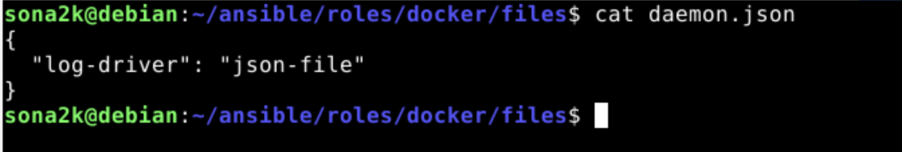

Tiedosto kopioidaan kohdekoneelle Ansiblen copy-moduulilla, ja Dockerille on määritelty handler, joka käynnistää palvelun uudelleen, kun asetustiedosto muuttuu.

Ajetaan playbook. Copy-tehtävä ja uudelleenkäynnistys-handler näyttävät changed, eli tiedosto päivittyi ja Docker käynnistyi uudelleen.

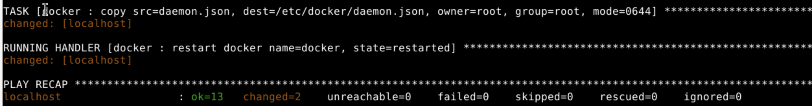

Tarkistetaan, että asetus tuli käyttöön komennolla:

    sudo docker info | grep -i "logging driver"

Muutetaan sitten asetustiedostoa herralla ja vaihdetaan lokien ajuriksi local.

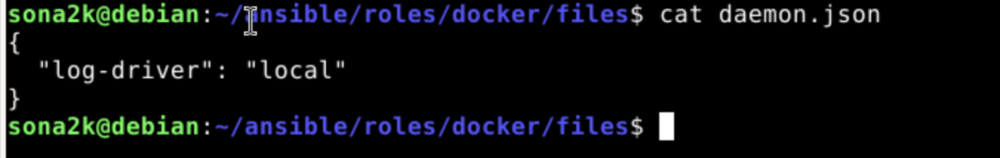

Ajetaan playbook uudestaan. Tiedosto kopioitui ja handler käynnisti Dockerin uudelleen (changed=2).

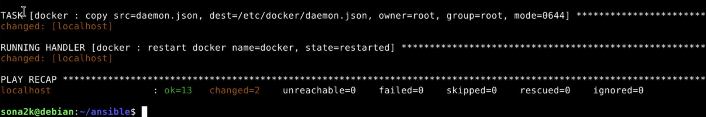

Lopuksi varmistetaan, että muutos on voimassa. Docker raportoi nyt lokien ajuriksi local, eli muutos ohjauskoneen asetustiedostossa siirtyi Ansiblen kautta käyttöön.

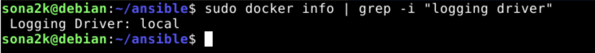

### d) Paikka remonttiin. Riko jotain asetuksia. Voit esimerkiksi poistaa demonin 'sudo apt-get purge foobar' (purge poistaa myös asetustiedostoja), poistaa asennuksen yhteydessä tulevan kansion (sudo rm -r /etc/foobar/ # vaarallista) tms. Ja sitten ajaa ansible-roolisi uudestaan ja todeta, että se korjaa tilanteen.

Rikotaan Docker kahdella tavalla. Ensin muokataan kohdekoneen asetustiedostoa käsin komennolla:

    sudoedit /etc/docker/daemon.json

Tiedostossa lokien ajuriksi on nyt json-file, vaikka Ansiblen kautta asetettu arvo on local.

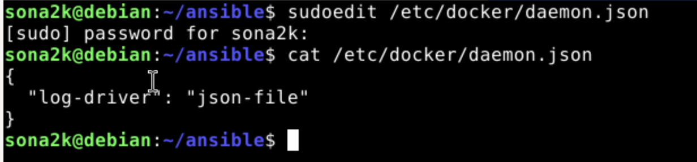

Sen jälkeen pysäytetään Docker-palvelu.

    sudo systemctl stop docker

Järjestelmä huomauttaa, että docker.socket on vielä aktiivinen, mutta itse palvelu pysähtyy.

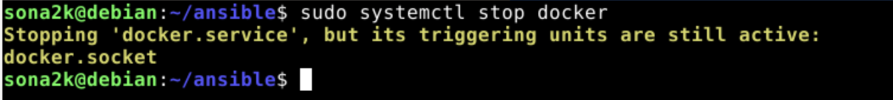

Varmistetaan, että palvelu on pois päältä.

    systemctl is-active docker

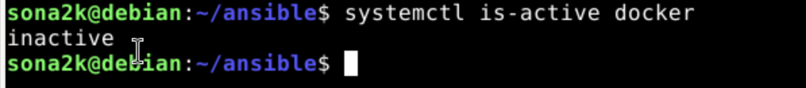

Ajetaan Ansible-playbook uudestaan. Nyt service-tehtävä (Docker käynnistetään) ja copy-tehtävä (asetustiedosto palautetaan) näyttävät changed, ja handler käynnistää Dockerin uudelleen. PLAY RECAP näyttää changed=3, eli Ansible korjasi molemmat viat: palvelu on taas käynnissä ja asetustiedosto on palautettu ohjauskoneen versioon.

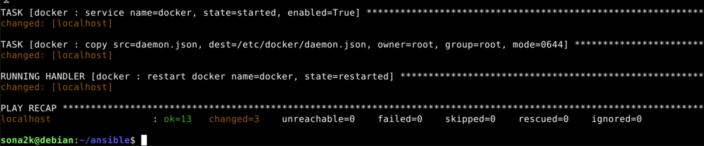

### e) Idempotentti. Osoita, että tilasi on idempotentti.

Ajetaan playbook vielä kerran heti korjauksen jälkeen. Kaikki tehtävät palauttavat ok ja PLAY RECAP näyttää changed=0. Mitään ei siis muutettu, koska järjestelmä oli jo halutussa tilassa. Tästä nähdään, että tila on idempotentti: saman playbookin voi ajaa useasti, ja lopputulos pysyy samana.

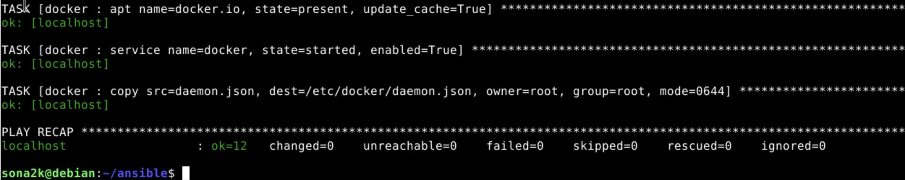

### Lähteet ja lisätiedot

https://westminsterresearch.westminster.ac.uk/item/w7vvz/configuration-management-of-distributed-systems-over-unreliable-and-hostile-networks

Claude Opus 5.5 mallia käytetty tekstin ja .md tiedoston muotoiluun.
