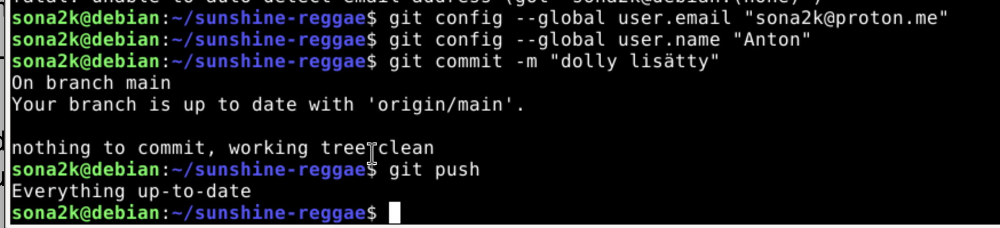
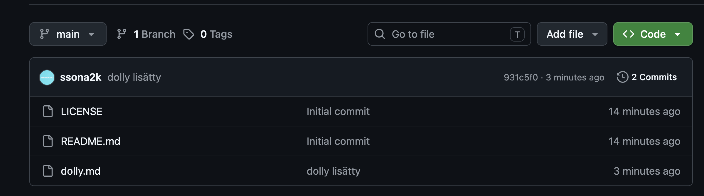
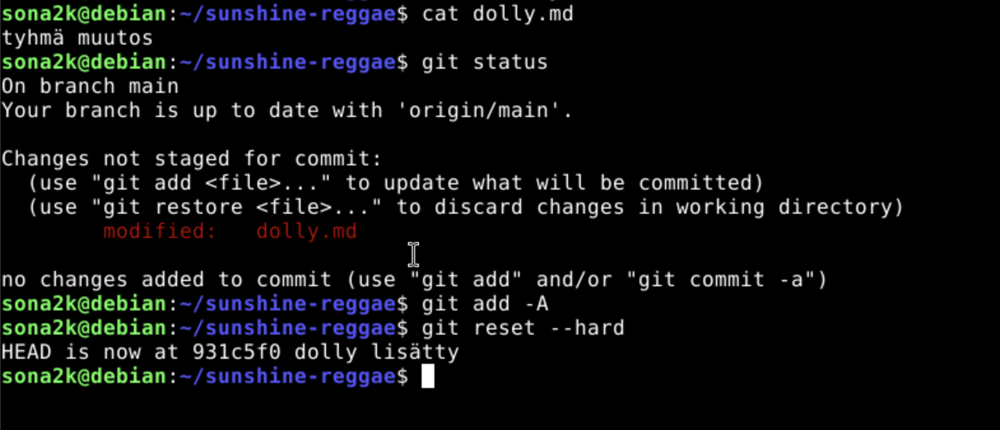
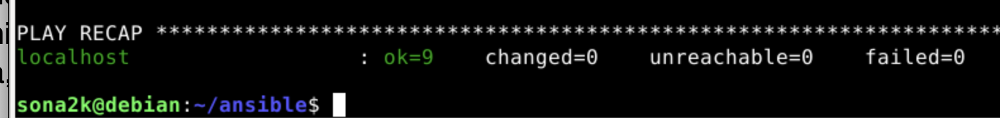
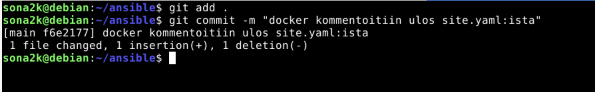

## h5

### x) Lue ja tiivistä: `git add --all && git commit; git pull && git push`

- **`git add --all`** siirtää työhakemiston muutokset staging-alueelle seuraavaa committia varten. `git add` aloittaa uusien tiedostojen seurannan ja lavastaa muokatut tiedostot (Chacon & Straub 2014, luku 2.2). Valitsin `--all` (lyhyesti `-A`) ottaa mukaan kaikki muutokset koko varastosta, myös poistetut tiedostot. (git-add)
- **`&&`** on Bashin ehdollinen ketjutus. Oikeanpuoleinen komento ajetaan vain, jos vasen onnistui. Commit tehdään siis vain, jos `git add` onnistui. (GNU Bash Reference Manual)
- **`git commit`** tallentaa staging-alueelle kootun tilannekuvan pysyvästi Git-hakemistoon. Muutokset, joita ei ole lavastettu, eivät tule mukaan. Ilman `-m`-valitsinta git avaa editorin commit-viestin kirjoittamista varten. (Chacon & Straub 2014, luvut 1.3 ja 2.2)
- **`;`** erottaa komennot toisistaan. Seuraava komento ajetaan aina, onnistui edellinen tai ei. Jos commitoitavaa ei ollut, `git pull` ajetaan silti. (GNU Bash Reference Manual)
- **`git pull`** hakee etävaraston muutokset ja yhdistää ne nykyiseen haaraan, jos haara seuraa etähaaraa. Se on käytännössä `git fetch` ja `git merge` peräkkäin. (Chacon & Straub 2014, luku 2.5)
- **`&&`** toisen kerran: `git push` ajetaan vain, jos `git pull` onnistui. Jos yhdistämisessä tulee konflikti, mitään ei lähetetä ennen kuin konflikti on korjattu.
- **`git push`** lähettää paikalliset commitit etävarastoon, esimerkiksi GitHubiin. Jos joku muu on ehtinyt pushata välissä, push hylätään, ja hänen muutoksensa pitää ensin hakea ja yhdistää omiin. Siksi `git pull` ajetaan ennen pushia. (Chacon & Straub 2014, luku 2.5)

### a) Online. Tee uusi varasto GitHubiin (tai Gitlabiin tai mihin vain vastaavaan palveluun). Varaston nimessä ja lyhyessä kuvauksessa tulee olla sana "sunshine". Aiemmin tehty varasto ei kelpaa. (Muista tehdä varastoon tiedostoja luomisvaiheessa, esim README.md ja GNU General Public License 3) Edistyneemmille voi olla hauskaa etsiä ja kokeilla jokin muu palvelu kuin Github.

Luodaan GitHubiin uusi julkinen repo nimeltä sunshine-reggae. Luomisvaiheessa varastoon lisätään README.md, jonka kuvaukseksi tulee "sunshine reggae repo palvelinten hallinnan kurssille", sekä lisenssiksi GNU General Public License 3.

### b) Dolly. Kloonaa edellisessä kohdassa tehty uusi varasto itsellesi, tee muutoksia omalla koneella, puske ne palvelimelle, ja näytä, että ne ilmestyvät weppiliittymään.

Kloonataan repo omalle koneelle komennolla:

    git clone https://github.com/ssona2k/sunshine-reggae.git

Varaston kansioon luodaan uusi tiedosto ja lisätään se versionhallintaan:

    touch dolly.md
    git add .
    git commit -m "dolly lisätty"

Ensimmäinen commit ei onnistunut, koska gitille ei ollut vielä kerrottu käyttäjän nimeä ja sähköpostia. Ne asetetaan komennoilla:

    git config --global user.email "sona2k@proton.me"
    git config --global user.name "Anton"

Tämän jälkeen commit onnistui ja muutokset puskettiin palvelimelle komennolla `git push`. Kuvassa ajettu uudestaan, eikä commitoitavaa tai pushattavaa enää ole.

GitHubissa näkyy nyt uusi tiedosto dolly.md ja commit "dolly lisätty".

### c) Doh! Tee tyhmä muutos gittiin, älä tee commit:tia. Tuhoa huonot muutokset ‘git reset --hard’. Huomaa, että tässä toiminnossa ei ole peruutusnappia.

Kirjoitetaan dolly.md-tiedostoon "tyhmä muutos". `git status` näyttää, että tiedostoa on muokattu, mutta muutosta ei ole commitoitu. Tuhotaan muutokset komennoilla:

    git add -A
    git reset --hard

HEAD palasi viimeisimpään committiin 931c5f0 "dolly lisätty", ja tyhmä muutos katosi.

### d) Tukki. Tarkastele ja selitä varastosi lokia. Näytä myös, mitä muutoksia tiedostoihin on tehty. Tarkista, että nimesi ja sähköpostiosoitteesi näkyy haluamallasi tavalla ja korjaa tarvittaessa.

Varaston lokia tarkastellaan komennolla:

    git log

Lokissa on kaksi committia, uusin ylimpänä. Jokaisesta näkyy hash, tekijä, päivämäärä ja commit-viesti.

Tekijän nimi näkyy molemmissa muodossa sona2k. Sähköpostina on ensimmäisessä commitissa sona2k@proton.me ja toisessa GitHubin noreply-osoite, joka piilottaa oikean osoitteen. Molemmat käyvät, joten korjattavaa ei ole.

### e) Gitanbile. Laita Ansible-kansio versionhallintaan. Tee jokin muutos, aja ansiblella, tallenna versio (commit).

Ansible-kansio laitetaan versionhallintaan komennoilla:

    git init
    git add .
    git commit -m "lisätään ansible kansio versionhallintaan"

Kansio oli jo aiemmin versionhallinnassa, joten git vastasi "Reinitialized existing Git repository" ja "nothing to commit, working tree clean".

Tehdään muutos site.yml-tiedostoon ja kommentoidaan docker-rooli pois käytöstä:

    - hosts: all
      become: true
      roles:
        - antero
        - paketit
        - tiedosto
        - nginx
    #   - docker

Ajetaan playbook. Kaikki tehtävät palauttavat ok ja changed=0. Roolin poistaminen ei poista Dockeria koneelta, vaan Ansible lakkaa vain hallitsemasta sitä, joten mitään ei muuttunut.

Lopuksi tallennetaan muutos versionhallintaan:

    git add .
    git commit -m "docker kommentoitiin ulos site.yaml:ista"

Git kertoo, että yksi tiedosto muuttui: yksi rivi lisättiin ja yksi poistettiin.

#### Lähteet

- Chacon, S. & Straub, B. 2014. *Pro Git*, 2nd Edition. Apress. <https://git-scm.com/book/en/v2>
  - Luku 1.3 What is Git? <https://git-scm.com/book/en/v2/Getting-Started-What-is-Git%3F>
  - Luku 2.2 Recording Changes to the Repository. <https://git-scm.com/book/en/v2/Git-Basics-Recording-Changes-to-the-Repository>
  - Luku 2.5 Working with Remotes. <https://git-scm.com/book/en/v2/Git-Basics-Working-with-Remotes>
- Git Reference Manual: git-add. <https://git-scm.com/docs/git-add>
- GNU Bash Reference Manual: Lists of Commands. <https://www.gnu.org/software/bash/manual/html_node/Lists.html>

Tekstin muotoiluun ja oikolukuun käytetty Claude Opus 5.5 mallia.
